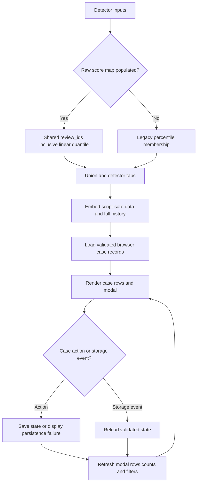

# Dashboard adversarial review

Data sources / inputs: `src/reporting/analyst_dashboard.py`, `tests/test_analyst_dashboard.py`, shared `src/evaluation/review_policy.py`, synthetic full score populations and browser case-state payloads.
Created: 2026-11-25
Last modified: 2026-11-25

Scope: dashboard implementation, its test module, and this record only. No commits; preserve concurrent edits elsewhere.

Plan: reproduce numerical selection failures; use shared `review_ids` for populated score dictionaries and retain per-detector percentile fallback for empty dictionaries; execute the emitted JavaScript to inspect persistence and reviewed-case flows; finish four bounded rounds and review the scoped diff.

Environment: Windows PowerShell, Python 3.13.1 via `py -3`, pytest 9.1.1, NumPy 2.2.6, pandas 2.3.1, Node.js 24.18.0, bundled Playwright and installed Chrome (headless). The `python` command resolves to an unavailable Windows Store alias; use `py -3` instead.

## Round 1 — science and data contracts

Command: `py -3 -m pytest tests/test_analyst_dashboard.py -k OfficialScoreSelectionTests -q`

Expected: exact five entities for 500 unique scores, all equal-score ties, inclusive boundary, full-population custom quantile, and per-detector fallback. Before implementation: **5 failed, 12 deselected**. Reproduced six instead of five, exclusion of all equal-score cases, selection of below-boundary cases, and incorrect classification from display percentiles.

Decision: reuse the user's shared policy rather than duplicate NumPy quantile logic. Percentile ranks remain display/sort inputs; membership and tab assignment share the selected ID sets. Populated score maps are authoritative, including entities missing display percentiles. Empty score maps retain legacy percentile membership. Shared policy rejects non-finite scores.

After implementation, selection assertions passed. One display assertion initially used double quotes while the existing markup uses single quotes; corrected the test. The pre-existing three-tab fixture's four scores could not support its asserted P99 intersection. Added 100 low-score controls to each full population (104 entities) to make that scenario mathematically consistent; explanation/history fixtures remain unchanged. `py -3 -m pytest tests/test_analyst_dashboard.py -q`: **17 passed**.

## Round 2 — state and integration

Command: `py -3 -m pytest tests/test_analyst_dashboard.py -k CaseStateTests -q --tb=short`

Expected: invalid saved entries never count as reviewed or export, and resetting a case while viewing reviewed cases immediately updates queue/recurrent KPIs and row visibility. Node executes the complete emitted script with a small DOM/storage adapter, rather than inspecting source strings.

Before correction: **7 failed, 1 passed, 17 deselected, 1 subtest passed**, including malformed-entry subtest failures and stale `1` instead of `0` for reviewed KPIs. Fixed by loading validated records into a null-prototype dictionary, validating own status names and timestamps, and refreshing the active tab after changes. Corrected rerun: **2 passed, 17 deselected, 7 subtests passed**.

Expanded scope from lead review: all inline JSON uses `_script_json` to escape `<`; storage read/write failures display an accessible message; matching storage events reload state and synchronize modal, rows, counts and filters. The storage key and entity-ID ownership stay compatible with existing saved state.

## Round 3 — failures and security

Commands:

- `py -3 -m pytest tests/test_analyst_dashboard.py -k CaseStateTests -q --tb=short`: **7 passed, 17 deselected, 12 subtests passed**.
- `py -3 -m pytest tests/test_analyst_dashboard.py -k 'BrowserDownloadTests or empty_populations' -q --tb=short`: **2 passed, 24 deselected, 8 subtests passed**.

Checks: malformed top-level JSON/arrays/scalars recover and survive save/reload; denied storage is visible while in-session changes remain exportable; external updates and clear synchronize state; unrelated keys are ignored; prototype-named IDs persist safely; inherited status names are rejected. Non-finite raw scores and invalid percentiles fail through the central policy; empty populations render no cases.

Actual malicious history and a malicious source column containing `</script><script>…` remain inside one script and round-trip unchanged. Chrome reports no injected global or page errors. Download bytes are inspected from actual browser download files: `efbbbf` BOM, CRLF delimiters, four history lines (header plus three periods), two reviewed-case lines, and retained malicious text as CSV data.

Failed hypothesis: the reported literal CSV escape bug was **not reproduced** in the original Python emitter. Its doubled Python escapes correctly become single JavaScript escapes and real download bytes. Reducing the Python escaping introduced an emitted-JavaScript syntax error, caught by the executable tests; restored the original correct emitter. Both history and reviewed-case paths now have a real-byte regression guard; no unnecessary emitter change remains.

## Round 4 — user flows and release checks

Executed the lead's unchanged `tests/review_flows.cjs` against this test module's freshly generated temporary dashboard. Invocation: a `py -3 -` wrapper loads the fixture with `runpy.run_path`, substitutes only the artifact path expression in the runner **in memory**, then calls `node -e <runner> <temporary-dashboard-path>`. No report artifact or other worker's file was overwritten.

Expected and actual: **PASS** first use, daily state changes, weekly reload, monthly profile remap, tabs/KPI coherence, history download and widths **390, 768, 1440**; page errors **[]**.

Added a real second Chrome tab to the byte test to verify native storage events after a remote reset. Initial harness attempt used Playwright's single-page `browser.newPage()` convenience context and failed with `Please use browser.newContext()` (**1 failed, 44 passed**). Corrected the test to create an explicit shared context before opening both pages.

Final commands:

- `py -3 -m pytest tests/test_analyst_dashboard.py tests/test_review_policy.py tests/test_oot_report.py -q --tb=short` — **45 passed, 44 subtests passed, 1 warning**, 10.24 seconds. Includes native two-tab storage synchronization and actual download bytes.
- `py -3 scripts/quality_gate.py` — **QUALITY PASSED (legacy debt remains)**. Existing dashboard complexity is reported as 50; the shared policy and new Python helpers pass the ceiling. No baseline edits.
- `git diff --check -- src/reporting/analyst_dashboard.py tests/test_analyst_dashboard.py` — **PASS**, no whitespace errors.

## State flow and operational limits

Assumptions: each populated raw-score map is the complete deduplicated detector population; empty maps mean legacy percentile-only input. Case state remains per entity and output pathname across regenerated reports. No schema/version migration is required.

Limits: synthetic tests prove selection and workflow behavior, not operational detection quality. Storage events synchronize sequential edits; localStorage still has last-writer-wins semantics for simultaneous writes and is not a shared transactional database. Storage failure retains only the current session and explicitly advises exporting. Browser tests require installed Chrome and bundled Playwright, with `CHROME_PATH` / `PLAYWRIGHT_MODULE` overrides. The combined suite emits an existing constant-input Spearman warning from the chart tie test. Full repository CI was not run by this scoped worker.

Rollback: revert only the dashboard and its test changes from this task; keep the independently owned shared policy and all concurrent work. No commits, deployments or external writes were performed.
