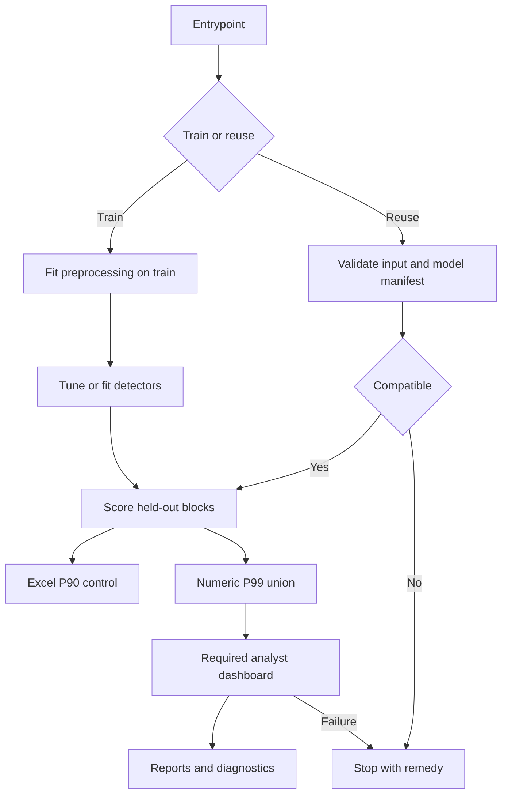
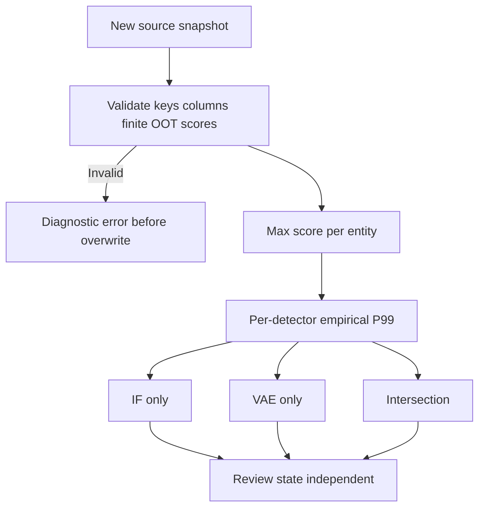
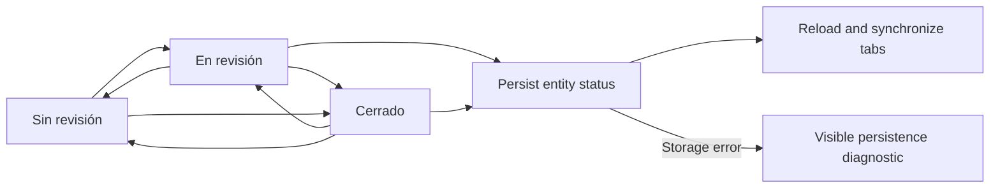

# Production review — 2026-11-25

Completion note2026-11-26: the interrupted review's final executable revision
`7a7987f` passed CI run45710038004. Subsequent report changes and their completed
validation are recorded in `docs/report_refresh_task_ledger.md`. The running
statuses below reflect the original review checkpoint, not a currently running
job. The explicitly listed architecture backlog remains separate work.

## Plan and resume ledger

| Task | Owner | Status | Evidence |
|---|---|---|---|
| GitHub inventory, PRs, CI, deployments | Lead | Done | No open PRs, no workflow runs; Pages 404, deployments [] |
| Numeric P99 vs rank boundary, ties, dashboard state | Dashboard worker | Done | docs/dashboard_redteam.md |
| Source drift and Excel export validation | Export worker | Done | Four rounds: 2/2/4/11 tests; 24 subcases final |
| Complexity/tautology gate and CI | Quality worker | Done locally; CI running | Four rounds: 15/17/19/19; max new gate complexity 8 |
| State machine/stack inventory | Architecture worker | Done | Findings integrated below |
| Four adversarial integration rounds | Lead | Done locally | Commands/results below |
| Docs, HTML, commit, CI and publication | Lead | Published; CI running | 2ca90d9, Actions 45708556189 |

Resume from the first incomplete task. Existing P90 Excel control and P99
operational dashboard contracts remain authoritative.

## Evidence-based route comparison

The prior dashboard selected percentile rank >=99 while Excel used score >=
NumPy's interpolated P99. These differ at the boundary and for tied scores.
Use the numeric cutoff for decisions, ranks only for display. Test 500 distinct
scores, constant scores and ties before integrating. A strict top-N cap was
rejected because it arbitrarily splits equal scores.

Complexity: enforcing <=10 over all legacy code immediately would require a
large behavior-changing refactor. Adopt a transparent no-increase baseline for
existing debt and enforce <=10 on new functions. This is staged compliance,
not a claim that legacy functions meet the ceiling.

Connection pooling/outbox: this app is a local batch pipeline with static HTML
and local artifacts. No transactional web service was found. Adding those
patterns would introduce operational burden without solving this boundary bug.
Shared case management will require a backend and concurrency design before
multi-user production use; localStorage is browser-local.

## Primary sources consulted

- NumPy percentile: https://numpy.org/doc/stable/reference/generated/numpy.percentile.html
- Scikit-learn leakage: https://scikit-learn.org/stable/common_pitfalls.html
- MDN storage events: https://developer.mozilla.org/en-US/docs/Web/API/Window/storage_event
- Radon complexity: https://radon.readthedocs.io/en/stable/api.html
- pandas copy-on-write: https://pandas.pydata.org/pandas-docs/stable/user_guide/copy_on_write.html
- Playwright CI runtime: https://playwright.dev/docs/ci

Research retrieval: 2026-11-25. These sources support method choices, not claims
of fraud detection accuracy or universal production readiness.

## Stack and deployment inventory

Repository: https://github.com/Mirloct/MV_v1, branch main. Python 3.13.1,
NumPy 2.2.6, pandas 2.3.1, sklearn 1.7.2, PyTorch 2.9.1, Optuna 4.9.0
were observed locally. Dependency minimums are in requirements.txt.
Training entrypoints: main.py, train_no_suite.py; reuse entrypoints:
best_params_no_suite.py and suite_plus_sensitivity.py.

Backend: local Python process. Data: artifacts/data. Models: artifacts/models;
synthetic artifacts under _dev. Database: local SQLite Optuna studies under
artifacts/tuning. UI: generated static HTML under artifacts/reports; live
progress uses ThreadingHTTPServer bound to 127.0.0.1 on an ephemeral port.
Workers: sklearn jobs, SHAP subprocesses with timeout, daemon progress threads.
No cloud hosting, GitHub Pages or deployment target was verified. GitHub
deployments returned an empty list and Pages returned 404. A GitHub push
publishes code and starts CI; it does not deploy a hosted production service.

Prior Claude guidance and CONTEXT.md were inspected as historical assertions,
not as runtime proof. No personal transcripts or credentials were read.

## State machines

| Machine | States and invariants | Main owner |
|---|---|---|
| Execution mode | train/reuse × suite on/off; shorthand resolves once | main.py |
| Provenance | absent→generate; loaded→synthetic/dev or official | data/loader.py |
| Temporal membership | train, val, test, OOT disjoint masks | evaluation/splits.py |
| Run/phase | running→success/failed/cancelled; required failure terminates | utils/observability.py |
| Training | new/resumed/incompatible→trial/refit/fallback | models/ |
| VAE health | healthy/warning/collapsed | models/vae.py |
| Labels | unknown/excluded/known; immature→mature; episodes | evaluation/event_labels.py |
| Gate 4.5 | rojo, ambar_1, ambar_2, verde_condicionado; veto→rojo | label_gate.py |
| Diagnostics | EXECUTED/NOT_APPLICABLE/UNAVAILABLE/FAILED/NOT_REQUESTED | ifvae_contract.py |
| Threshold | POT succeeds or percentile fallback; operational P99 separate | thresholds.py |
| Detector membership | IF-only/VAE-only/intersection | analyst_dashboard.py |
| Case review | sin_revision/en_revision/cerrado; independent of detector | analyst_dashboard.py |
| UI | tab/search/modal/download; model data immutable per HTML | analyst_dashboard.py |
| Live/worker | polling→terminal; worker done/error/timeout→kill/fallback | flow_visualization.py |

## Four adversarial integration rounds

1. Science: compare numeric P99 with rank boundary; constant/tied/nonfinite
   score tests, full-population denominator, report union reconciliation.
2. Input drift: missing/duplicate columns, empty data, invalid entity, numeric
   text, NaN/infinity, invalid percentiles, workbook preservation/recovery.
3. State/security: hostile history, malformed storage, explicit status changes,
   script escaping, real CSV bytes and persistence behavior.
4. Integrated flows/release: root suite, browser tab/count checks, daily/weekly/
   monthly profile remap, mobile widths, quality gate and GitHub CI.

Failed validation hypotheses: the initial browser check sampled before the
requestAnimationFrame filter completed; waiting two frames corrected the test.
It initially inspected hidden flags without rendered visibility. Both test
errors were fixed before interpreting any application result.

## Operational limits and follow-up

This review cannot certify model accuracy on operational data without reviewed
outcomes and representative historical replay. Monthly simulation exercises
profile remapping; it does not establish longitudinal model quality. Browser
storage is local and lacks transactional multi-user case management. Immutable
run directories, content-bound provenance, locked dependencies and an explicit
model-health promotion policy remain separate architecture work. No evidence
supports introducing distributed outbox/pooling into the current static app.

## Executed evidence and trade-offs

- Root suite before the last additions: `py -m pytest -q tests` — 422 passed,
  45 subtests; 10 pre-existing numerical warnings, 271.51s.
- Final focused integration at 2ca90d9: 100 tests, 80 subtests passed across
  policy, reuse, Excel, browser, gate and report modules (12.29s).
- Numeric review policy tests: 9 passed, including critical-health rejection,
  constant score ties, nonfinite source rejection and chart agreement.
- Browser flow `node tests/review_flows.cjs`: first use, daily review, weekly
  reload, monthly profile remap and widths 390/768/1440 passed; no page errors.
- Dashboard specialist: four adversarial rounds, 45 tests and 44 subtests;
  hostile inline history, native second-tab storage events and actual CSV bytes.
- Quality gate: 93 explicit legacy exceptions; no increases accepted. Dashboard
  complexity decreased 54→50. New policy helpers and gate functions stay <=10.
- Legacy model reuse smoke completed (run 0b11ac08fbe9), producing 50 control
  rows/model and the numeric P99 union. This began before manifest integration.
- A separate default/no-tune training smoke reproduced critical latent collapse
  (0/8 active dimensions). The new release gate now rejects that verdict rather
  than treating it as a successful operational result. Retune/model research is
  still needed before that candidate can be promoted.

The proposed CSV escaping defect was rejected by real downloaded-byte evidence:
the original emitter already produced BOM and CRLF correctly. No unnecessary
escape rewrite was retained. The review did find and fix actual script injection.

Model reuse guard trade-off: an unchanged feature count is insufficient. The
manifest conservatively binds in-time transformed data, fitted preprocessing,
ordered features and model checksums. Existing models require retraining once;
changed training/validation windows require a new contract. Arbitrary future
inference needs a persisted full bundle, not a relaxation of this guard.

The required analyst artifact now fails closed. Optional diagnostics retain
their existing explicit availability states. The additional latent-health gate
is an operational acceptance rule on the existing measured critical verdict,
not evidence that absence of collapse proves detection quality.

Release: code published as 2ca90d9. New CI run:
https://github.com/Mirloct/MV_v1/actions/runs/45708556189 . No open issues/PRs were
returned by GitHub. There is no verified hosted target to redeploy.

## Remaining architecture backlog

1. Persist and load a complete preprocessing/stacking/model/calibration bundle
   for inference on new windows; current guard deliberately restricts reuse.
2. Bind data-provenance markers to content and fail closed on marker loss.
3. Use immutable run-specific directories. Overlapping batch writers are now
   rejected by an OS-managed artifact lock; immutable publication remains pending.
4. Establish reviewed operational replay/labels, segment checks and promotion
   criteria for scientific quality; investigate the default quick-model collapse.
5. Design shared case persistence with revisions/conflict handling if multiple
   analysts must write concurrently. Current storage is last-writer-wins.
6. Pin production dependencies and choose an actual hosting target/operations
   owner before deploying a production service.

These are explicit remaining limits, not completed work or a production-readiness
certificate. Safe resume point: verify the CI result, then start backlog item 1
with an isolated bundle migration and its own replay tests.

Additional release check: `tests/test_run_lock.py` passes real descriptor
contention and release-on-exception. The serialized `run_pipeline` rejects an
overlapping writer before entering the pipeline, avoiding conflicting report,
model and progress outputs. OS locks release after process exit; no stale PID
deletion heuristic is used.

## Fresh-environment CI findings

The first Linux CI run failed despite the Windows suite passing. Thirty tests
and ten setup errors traced primarily to pandas' copy-on-write arrays becoming
read-only, plus one browser test requiring an unavailable machine-local runtime.
The fix requests independent writable copies only where categorical codes and
label targets are mutated. It preserves source Series and leaves copy-on-write
enabled. New drift fixtures exercise object/string/category dtypes, missing and
unknown levels, empty inputs and conflicting reviewed labels.

CI now installs the pinned Playwright 1.62.1 package and Chromium dependencies,
then uses the provisioned runtime. The Windows Chrome override remains optional.
Tests are retained and run, not skipped to hide provisioning errors.

Independent reuse review reproduced stale-YAML stacking drift up to 0.1462 in
score despite valid file hashes. Actual loaded IF parameters are now the sole
source for reconstruction; VAE report parameters likewise come from the loaded
detector. A real fitted/save/load forest regression checks identical stack scores.
Main orchestrator complexity was reduced from 209 to 205 in this correction.

The final critical-health smoke, run bfb10f471793, accepted the matching reuse
manifest, detected 0/8 active VAE dimensions and terminated with exit code 1
and an explicit Phase 7 acceptance diagnostic before operational publication.
This verifies the negative path; it is not a successful model-quality result.
